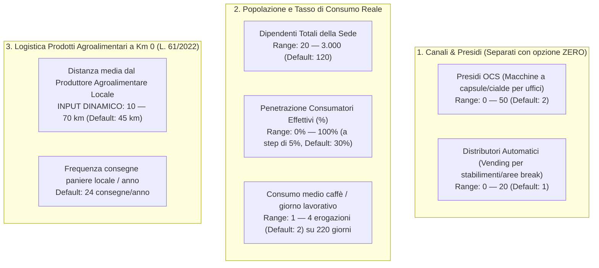

# Architettura Definitiva del Nuovo Simulatore d'Impatto
**Progetto:** Illiria Coffee Impact  
**Documento di Riferimento Locale:** [`doc/specifica-nuovo-simulatore-definitiva.md`](file:///c:/Users/user/Documents/illiria-coffee-impact-landing-page-glm-cause-related-marketing-con-biglietti/doc/specifica-nuovo-simulatore-definitiva.md)  
**Stato:** Specifica Esecutiva Validata per l'Aggiornamento del Codice

---

## 1. La Nuova Mappa degli INPUT (Colonna Sinistra)

---

## 2. Il Confronto Logistico Dinamico (Sotto il Riquadro Input)

Nessun valore fisso o arbitrario: la percorrenza evitata è calcolata direttamente dall'**Input della Distanza del Produttore** (da 10 a 70 km, ai sensi della L. 17 maggio 2022, n. 61).

- **Tragitti andata/ritorno evitati:**  
  $$\text{Km per ciclo a/r} = \text{Distanza Produttore (km)} \times 2$$
  *(Es. se imposti 45 km, il tragitto a/r autonomo è $45 \times 2 = \mathbf{90\ \text{km}}$; se imposti 60 km è $60 \times 2 = \mathbf{120\ \text{km}}$; se imposti 70 km è $70 \times 2 = \mathbf{140\ \text{km}}$).*
- **Consegna con Sinergia Flotta Illiria:**  
  $\rightarrow$ **0 km aggiuntivi** (i prodotti agroalimentari viaggiano a bordo dei furgoni Illiria durante i giri ordinari di rifornimento OCS/Vending già pianificati).
- **Bilancio Logistico Totale Annuo:**  
  $$\text{Km Totali Risparmiati} = \text{Km a/r} \times \text{Numero Consegne Annue}$$
  $$\text{CO}_2\text{ Evitata} = \text{Km Totali Risparmiati} \times 0{,}28\ \text{kg CO}_2/\text{km}$$

---

## 3. Superamento del Vecchio "0,02 € / caffè" e Nuova Architettura del Valore

> [!IMPORTANT]
> **Il vecchio modello a centesimi (0,02 €) è superato.**  
> Il valore generato per l'impresa e il territorio non è un minuscolo rimborso monetario, ma un pacchetto organico ad altissimo valore aggiunto generato dalla Startup:
> 
> $$\mathbf{Valore\ Globale\ Generato} = \mathbf{Valore\ Biglietti\ Omaggio} + \mathbf{Valore\ Servizi\ di\ Comunicazione\ Startup} + \mathbf{Indotto\ Economico\ Locale}$$

### I 3 Componenti del Valore:
1. **Valore dei Biglietti Omaggio Performing Art:**  
   $$\text{Biglietti} = \left\lfloor \frac{\text{Erogazioni Totali}}{1.000} \right\rfloor \times 5$$  
   $$\text{Controvalore Biglietti} = \text{Biglietti} \times \mathbf{15{,}00\ \text{€}}\ \text{(prezzo medio al botteghino)}$$
2. **Valore Equivalente dei Servizi di Comunicazione forniti dalla Startup:**  
   - Se un'azienda acquistasse singolarmente questi servizi sul mercato da agenzie di consulenza e agenzie creative di comunicazione, spenderebbe tra 3.000 € e 5.000 €.
   - Attraverso la Startup (che mutualizza e scala la produzione con un budget di 30.000 € distribuito su 100–200 imprese target), il **valore equivalente effettivo riconosciuto a ciascuna impresa aderente è quantificato realisticamente in 1.200 € / anno**.
3. **Indotto Economico Locale Generato (Moltiplicatore Economico Territoriale $\times 2{,}4$):**  
   - I biglietti omaggio e le rassegne nelle Aree Interne delle Marche attivano un indotto economico locale (ristorazione, pernottamenti, visite ai borghi, acquisto di prodotti tipici locali).  
   - Secondo i moltiplicatori di spesa turistica e culturale certificati per le aree interne, ogni euro investito in cultura genera un **moltiplicatore di $\times 2{,}4$** a favore delle economie delle comunità ospitanti:  
     $$\text{Impatto Economico Locale} = \text{Valore Biglietti} \times 2{,}4$$

---

## 4. La Nuova Matrice dei 6 OUTPUT (Griglia Nera)

| Riquadro | Etichetta a Schermo | Valore Calcolato | Didascalia / Unità | Significato Strategico |
| :---: | :--- | :--- | :--- | :--- |
| **1** | **EROGAZIONI TRACCIATE / ANNO** | `r.erogazioni` | `OCS + Vending (consumi reali)` | Volume annuo basato sulla percentuale reale di consumatori su 220 giorni lavorativi. |
| **2** | **KM DI TRASPORTO EVITATI** | `r.km` | `km consegne dedicate azzerate` | Percorrenza a/r del produttore a Km 0 evitata grazie alla sinergia della flotta Illiria. |
| **3** | **CO₂ EVITATA** | `r.co2` | `kg CO₂ da logistica combinata` | Emissioni evitate calcolate a $0{,}28\text{ kg CO}_2/\text{km}$ (ISPRA veicoli commerciali). |
| **4** | **BIGLIETTI OMAGGIO PERFORMING ART** | `r.biglietti` | **5 biglietti ogni 1.000 erogazioni** | Biglietti gratuiti per rassegne e festival nelle Marche (valore facciale 15 € cad.). |
| **5** | **PUNTI IMPATTO BORSELLINO** | `r.punti` | **1 punto ogni 100 erogazioni** | Punti per sbloccare i Tier aziendali, sconti riordino Km 0 e diritto di voto del team sui festival. |
| **6** | **VALORE COMPLESSIVO GENERATO** | `€ r.valoreTotale` | `Welfare + Comunicazione + Indotto` | Biglietti (@ 15 €) + 1.200 € Servizi Startup + Indotto Locale (moltiplicatore $\times 2{,}4$). |

---

## 5. La Nota Metodologica Integrata nel Simulatore

Sotto i risultati del simulatore, viene inserito un riquadro espandibile/nota metodologica ben visibile:

> ### 📋 Nota Metodologica: Servizi di Comunicazione e Valore Equivalente della Startup
> Il valore complessivo include **1.200 € / anno di Servizi di Comunicazione e Reporting d'Impatto** forniti direttamente dalla Startup a ciascuna impresa aderente. Il pacchetto comprende:
> - **Content Creation & Asset Grafici:** Materiali multimediali per la comunicazione interna aziendale (totem area break, locandine con QR code, template newsletter per i dipendenti);
> - **Gamification & Concorsi a Premio Interni:** Gestione della Web App per l'assegnazione dei biglietti e le votazioni del team sui festival sostenuti;
> - **Comunicazione Best Practice & Relazioni Pubbliche:** Redazione e diffusione di comunicati stampa congiunti sui media regionali e inclusione del brand aziendale nel cartellone ufficiale delle rassegne nelle Marche;
> - **Certificati di Impatto Asseverati:** Rilascio di attestati digitali con hash crittografico e marcatura temporale per la valorizzazione delle Aree Interne e dei prodotti agroalimentari a Km 0 (L. 61/2022), con dataset precompilato per il fascicolo di sostenibilità (GRI / CSRD).

---

## 6. Il Riquadro "Dove Finisce il Valore Generato"

Aggiornato per riflettere le 3 dimensioni reali:

1. **Welfare Culturale Dipendenti (€):**  
   $$\text{Valore Biglietti Omaggio} = \text{Biglietti} \times 15\ \text{€}$$  
   *In biglietti gratuiti per spettacoli teatrali, concerti e rassegne nelle Marche ceduti ai collaboratori.*
2. **Servizi di Comunicazione & Visibilità Impresa (€ 1.200):**  
   *Asset editoriali, ufficio stampa, gestione web app, certificati digitali e supporto al reporting ESG forniti dalla Startup.*
3. **Indotto Economico Comunità Locali (€):**  
   $$\text{Indotto Territoriale} = \text{Valore Biglietti} \times 2{,}4$$  
   *Spesa stimata attivata nei 24 Comuni delle Aree Interne marchigiane in pernottamenti, ristorazione e prodotti tipici.*

